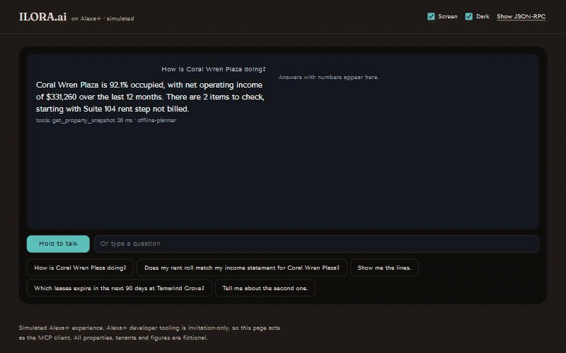
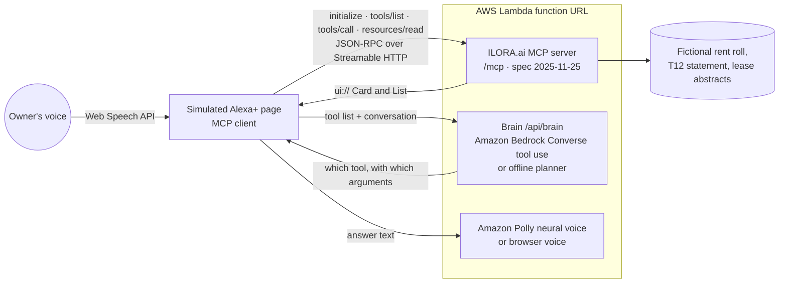

# ILORA.ai on Alexa+

**Ask Alexa how your building is really doing, and ILORA.ai answers with checked numbers and tells you exactly which figure doesn't add up and where it came from.**

> "Alexa, does my rent roll match my income statement for Coral Wren Plaza?"
> "Not quite. Rental income is $13,500 short of the rent roll, mostly from Suite 104, whose lease shows a rent step in March that wasn't billed, $9,000. The other $4,500 is a CAM reconciliation for Suite 108 posted to base rent instead of CAM recoveries. Want me to show the lines?"

This repository is a self-hosted **MCP server** (spec **2025-11-25**, **Streamable HTTP**) for Alexa+, plus a **simulated Alexa+ client** in the browser that drives it.

**Read this first, plainly:**
- **The Alexa+ experience is simulated.** The Alexa+ MCP Toolkit, CLI and Web Simulator are available to select partners only, so participants cannot connect a server to a real Alexa+ device. The simulator page is a real MCP client (initialize, tools/list, tools/call, resources/read over Streamable HTTP), which the hackathon FAQ accepts for this track. Nothing here claims Alexa+ certification.
- **All data is fictional.** Coral Wren Plaza and Tamarind Grove Apartments, their tenants and every number are made up for the demo. The issues the demo finds were built into the data on purpose and are asserted to the dollar by tests.



*22 seconds, captured from the running simulator: snapshot, the rent roll check with its Card and source lines, expiring leases with a follow-up, voice only, and the raw MCP traffic.*

## Run it locally in five minutes

Needs Node.js 20 or later. No accounts or keys.

```bash
git clone https://github.com/gSimani/ilora-alexa-mcp.git
cd ilora-alexa-mcp
npm install
npm run dev
```

Open http://localhost:8787 for the simulator, and press a demo question or hold **Hold to talk** (Chrome or Edge for voice input). The MCP endpoint is http://localhost:8787/mcp.

Check it with the official MCP Inspector:

```bash
npx @modelcontextprotocol/inspector --cli http://localhost:8787/mcp --transport http --method tools/list
```

Run the tests (unit, schema, golden conversation, latency):

```bash
npm test
```

By default the simulator uses an **offline planner** to choose tools, so it runs with no AWS account. With AWS credentials you can switch the brain to Amazon Bedrock and the voice to Amazon Polly:

```bash
BRAIN=bedrock BEDROCK_MODEL_ID=us.amazon.nova-lite-v1:0 VOICE=polly AWS_REGION=us-east-1 npm start
```

The simulator header shows which brain and voice answered, every turn.

## How it works



1. The page connects to `/mcp` and lists the tools, exactly as Alexa+ would.
2. Each question goes to the brain with that tool list. The brain picks a tool and arguments: Amazon Bedrock when `BRAIN=bedrock`, otherwise the offline planner. (Our AWS account currently gets Bedrock's account-level "Error 002", see the friction log, so the recorded demo uses the offline planner and says so on screen.)
3. **The page itself** calls the tool over MCP and hands the structured result back to the brain, which writes the spoken answer.
4. For the two visual tools, the page reads the tool's `ui://` resource and renders it inline with the MCP Apps protocol (`ui/initialize`, `ui/notifications/tool-result`).
5. **Show JSON-RPC** opens every request and response, so you can see the protocol traffic is real.

## The tools

One customer intent per tool. Every tool declares an `outputSchema` and returns matching `structuredContent`. Tools never script speech; Alexa writes the reply. Errors come back with `isError` and a JSON body that offers alternatives.

| Tool | Customer asks | Returns |
|---|---|---|
| `list_properties` | "What properties do I have?" | id, name, type and city for each property |
| `get_property_snapshot` | "How is Coral Wren Plaza doing?" | occupancy and its basis, rent roll rent and statement rental income (trailing 12 months), NOI, open flag count, top flag |
| `check_rent_roll_vs_statement` | "Does my rent roll match my income statement?" | both totals, the gap, ranked causes with rule, reason, fix and source document, page and line. **MCP Apps Card** |
| `list_expiring_leases` | "Which leases expire in the next 90 days?" | leases ending in `months_ahead` (default 12) with position, stable `item_id`, rent and share of income. **MCP Apps List** |
| `explain_flag` | "Show me the lines" / "tell me about the first one" | rule, figures, every source citation, suggested fix |

Example call:

```bash
curl -s http://localhost:8787/mcp \
  -H 'Content-Type: application/json' -H 'Accept: application/json, text/event-stream' \
  -H 'Mcp-Protocol-Version: 2025-11-25' \
  -d '{"jsonrpc":"2.0","id":1,"method":"tools/call","params":{"name":"check_rent_roll_vs_statement","arguments":{"property":"Coral Wren Plaza"}}}'
```

An unknown property returns `isError: true` with `{"error":{"code":"unknown_property","did_you_mean":[...]}}`. The error JSON lives in the text content rather than `structuredContent`, because MCP clients validate `structuredContent` against the success schema.

## The demo data

| Property | Type | What the check finds |
|---|---|---|
| Coral Wren Plaza, Delray Beach, FL | 12-suite neighborhood retail center | Rent roll $412,000 vs statement $398,500. Gap $13,500 = Suite 104's March rent step never billed ($9,000) + a CAM reconciliation credit posted to Base Rent ($4,500) |
| Tamarind Grove Apartments, Boynton Beach, FL | 48-unit garden apartments | 3 leases end within 90 days, 9.0% of rent roll income; Unit B-12 shows occupied with no rent posted for July and August |

Files per property in [data/](data/): `rent_roll.csv`, `t12_operating_statement.csv` (general-ledger detail with document, page and line), lease abstracts as JSON, and `property.json`. Regenerate with `npm run data`. The shapes follow ILORA.ai's rent roll, lease abstract and statement records. In production the readers in [src/data.ts](src/data.ts) would call the ILORA.ai API instead of these files.

## Deploy to AWS

One Lambda function with a function URL serves the MCP endpoint, the simulator and the brain. It runs only while handling a request.

Needs the AWS SAM CLI and AWS credentials.

```bash
npm run build:lambda
sam deploy --guided --template-file template.yaml
```

Stack parameters: `Brain` (`offline` or `bedrock`), `BedrockModelId`, `Voice` (`browser` or `polly`). The function runs at most two copies at once, and the routes that can cost money (`/api/speak`, `/api/brain`) cap requests per hour per caller and in total; set an AWS Budgets alert as well before leaving a public URL up. The outputs give the MCP endpoint and the simulator URL. Bedrock and Polly bill per use, so they are off unless you turn them on. Remove everything with `sam delete`.

Test the bundle without deploying:

```bash
npm run build:lambda && node scripts/invoke-lambda-local.mjs "$(pwd)/.lambda"
```

### AWS services used

| Service | What it does here |
|---|---|
| AWS Lambda (function URL, Node.js 22, arm64) | Hosts the MCP server, simulator and brain. `/mcp` uses the SDK's web-standard Streamable HTTP transport |
| Amazon Bedrock (Converse API, tool use) | The brain: gets the MCP tool list and decides which tool to call, as Alexa+ does. Implemented and switched on by `BRAIN=bedrock`; not in the recorded demo because our account returned Error 002 |
| Amazon Polly (neural voice) | Reads the answer aloud. Used live on the deployed function |
| AWS SAM / CloudFormation | One-command deploy and teardown |

## Project layout

```
src/server.ts        MCP server and the five tools (schemas, structured errors)
src/ui.ts            MCP Apps Card and List views (ui:// resources)
src/domain.ts        The checks: reconciliation, expirations, flags, snapshot
src/data.ts          Fixture reader (the seam where the ILORA.ai API would plug in)
src/app.ts           Express app: /mcp (stateless Streamable HTTP), /health
src/lambda.ts        AWS Lambda handler
src/assistant/       Brain (Bedrock Converse or offline planner) and Polly route
simulator/           The simulated Alexa+ client
tests/               Data, tools, golden conversation, routing, latency
data/                Fictional demo dataset
submission/          Video script, Devpost text, product feedback, friction log
LICENSE              MIT
```

## Built during the hackathon

Everything in this repository was written during the submission window, starting October 19, 2026. It is a new, standalone project. ILORA.ai's production extraction and verification engine is not included; the checks in `src/domain.ts` were written fresh for this demo.

## License

[MIT](LICENSE), copyright Ilora AI, Inc.

The license covers this code. It does not grant any right to use the ILORA.ai name, logo or brand.

The checks in `src/domain.ts` were written for this demo. ILORA.ai's production extraction and verification engine is not part of this repository.
